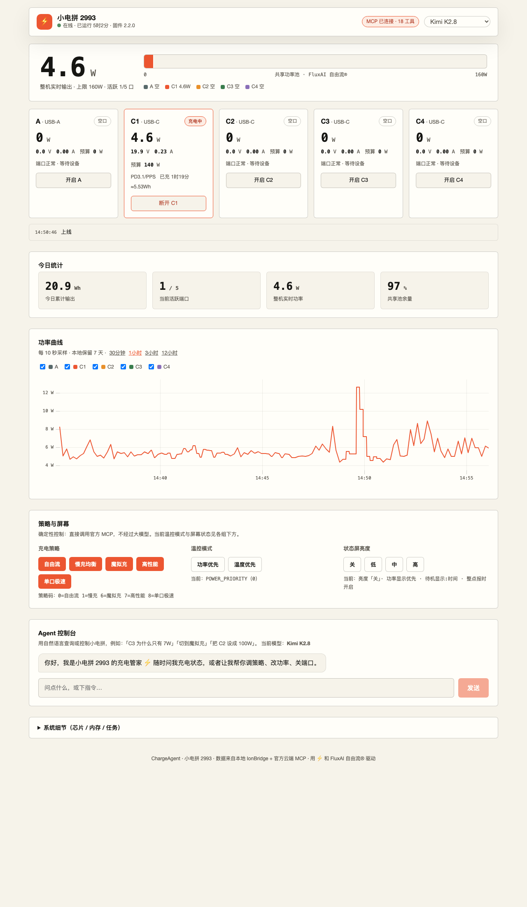
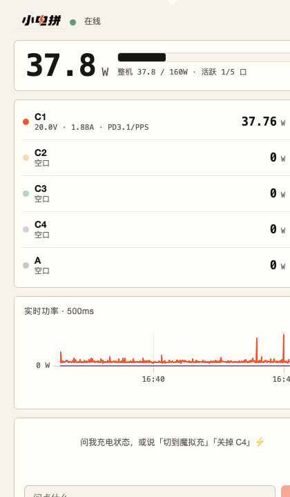

# ChargeAgent · 小电拼充电管家

运行在 macOS 菜单栏的充电管理应用：Candy 风格实时看板 + 双大模型（Kimi K2.8 / DeepSeek）自然语言控制 [CANDYSIGN 小电拼](https://thecandysign.com/cocan/zh/)。



## 功能

- **菜单栏常驻**：小电拼字标 + 定宽功率数字（明暗主题自适应），点击弹出紧凑面板，右键菜单，开机自启
- **实时看板**：500ms 级整机功率、五口 V/A/W 卡片、160W 共享池进度条、每口独立进度条
- **功率曲线**：30 分钟 / 1 / 3 / 12 小时历史 + 500ms 实时滚动模式，本地保留 7 天
- **端口控制**：每口三态（充电中 / 空闲 / 已关闭），物理断电等效拔线，状态与设备实时同步
- **温控与屏幕**：功率优先 / 温度优先、状态屏亮度四档，当前态高亮 + 人话文案
- **Agent 控制台**：自然语言查询与诊断（「C3 为什么只有 7W」「切到魔拟充」），工具调用全程可见，多会话持久化
- **设置中心**：设备 IP、兜底代理、云端 MCP、双模型 Key、刷新速率（250ms–5s），全部持久化热生效
- **桌面悬浮窗**：钉在桌面的纯读仪表（环形进度 + 五口状态点），位置记忆，托盘菜单开关
- **出厂零密钥**：所有凭证由用户在设置页自行填写



## 架构

```
小电拼 (局域网 HTTP) ──直连/代理双通道──▶ 采集器 ──▶ 环形缓冲 + 历史(JSONL)
        ▲                                                       
官方云端 MCP (SSE) ◀── 18 工具 · 自动重连 ── Express 后端 (127.0.0.1:8932)
                                                   │
                       网页版看板 ／ 菜单栏弹窗(#popover) ／ Agent(Kimi·DeepSeek)
```

- 外壳 Electron 34（菜单栏应用，Apple Development 签名）
- 后端 Express，打包后以 `ELECTRON_RUN_AS_NODE` 子进程自启
- 前端 Vite + React 19 + uPlot，同一构建两套布局
- 数据层零依赖 JSON/JSONL（兼容 Electron 内置 Node 20）
- 详见 [docs/PRD.md](docs/PRD.md)

## 快速开始

```bash
npm install
npm run dev        # 开发模式（网页版 http://localhost:7100）
npm run desktop    # 菜单栏应用（开发）
```

生产构建（会生成 `release/ChargeAgent.app`）：

```bash
python3 scripts/gen-tray-assets.py   # 先生成托盘资产（约 3204 张，未入库）
npm run build && npx electron-builder --mac --dir   # 或按 scripts/ 流程手动打包
```

## 配置（全部可在应用内「⚙ 设置」完成，持久化）

| 项 | 说明 |
|---|---|
| 设备地址 | 小电拼局域网地址，如 `http://192.168.8.68` |
| 兜底代理 | 直连被按应用 VPN（如 Shadowrocket）拦截时自动切换，默认 `http://127.0.0.1:1082` |
| MCP 地址 | 官方云端 MCP（含 PSN 与 token）：`https://mcp.thecandysign.com/<psn>/<token>/sse` |
| 大模型 | Kimi（`https://api.kimi.com/coding/v1`）/ DeepSeek，Key 仅本机存储 |
| 刷新速率 | 250ms–5s 五档，默认 500ms |

## 分发

arm64 构建；接收方首次打开需「右键 → 打开」。正式无警告分发需 Apple Developer Program（Developer ID + 公证）。**请勿把含自己 token 的 `.env` 或 MCP 地址发给他人。**

## 环境说明

- macOS Sequoia 对未签名 / adhoc 应用限制严格，需有效开发者证书签名
- 与按应用 VPN 共存：双通道 + 直连 60s 冷却，速率不受影响

## 许可

个人学习项目，品牌资产（小电拼 / CANDYSIGN / FluxAI 自由流®）归制糖工厂所有。
